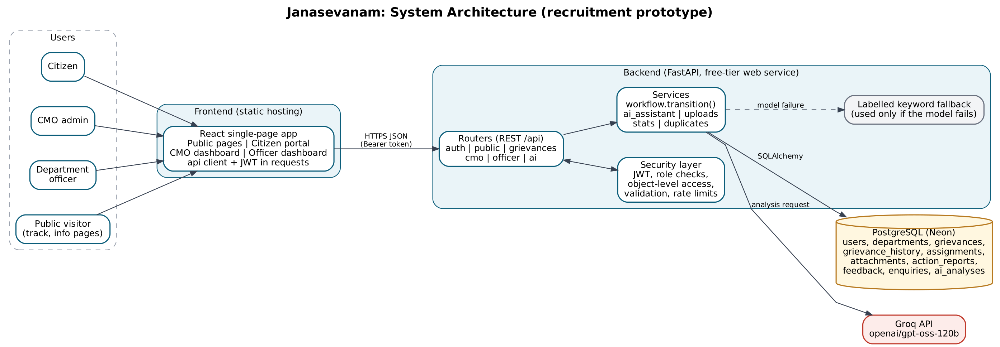
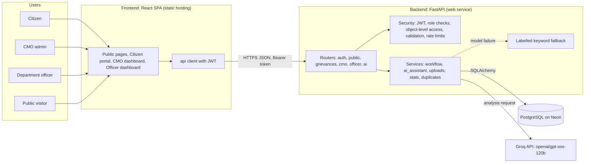
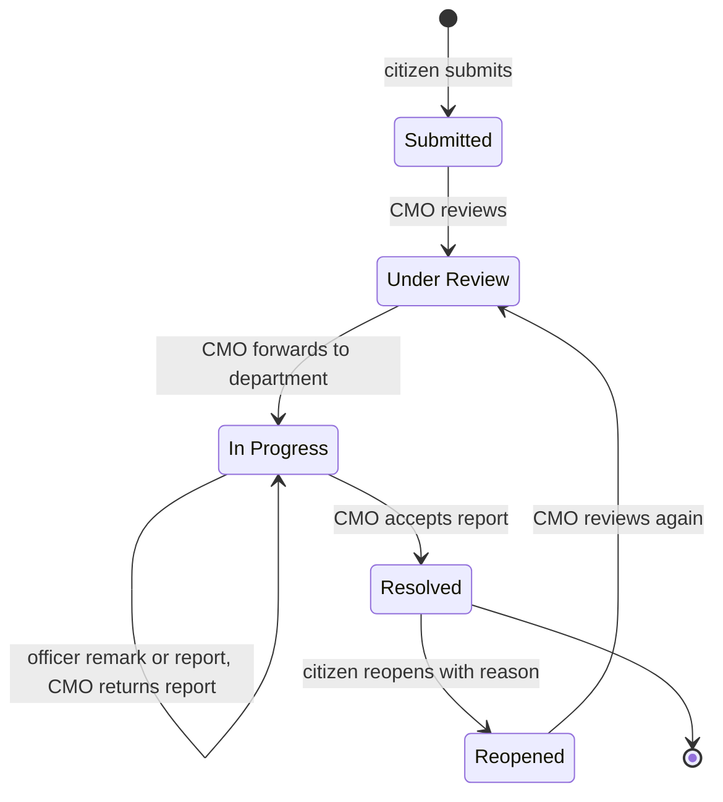
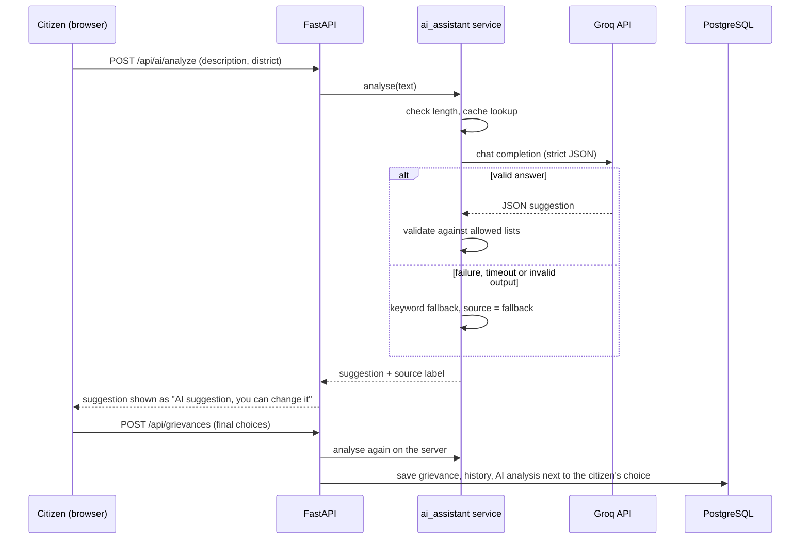
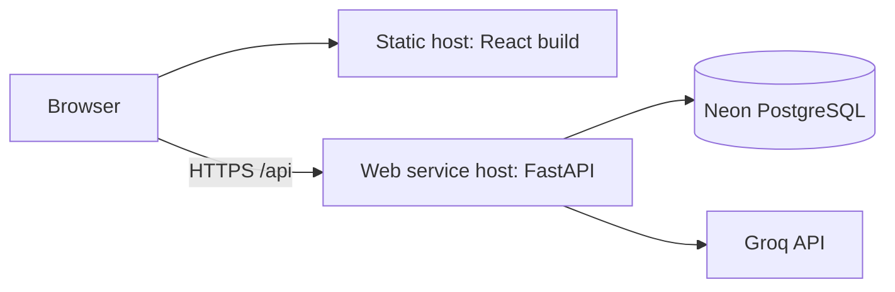

# 02. System Architecture

> **Recruitment prototype.** Not affiliated with or endorsed by the Government of Kerala or the Chief Minister's Office. All data is fictional.

This document describes the frontend, backend, database, APIs and AI architecture of Janasevanam.

---

## 1. Overview

The system has four main parts: a React single-page application, a FastAPI backend that exposes a REST API, a PostgreSQL database, and the Groq API for AI analysis. The browser never talks to the database or to Groq directly; everything goes through the backend, which enforces authentication, roles and business rules.



The same diagram in Mermaid (rendered by GitHub):



## 2. Frontend

| Item | Detail |
|---|---|
| Framework | React, with Tailwind CSS. The interface was designed in Figma Make and exported as the front-end project |
| Routing | Public routes, and role-protected routes for citizen, CMO and officer areas. Login redirects by role; protected routes redirect to login |
| Data access | One API module holds every call to the backend. Screens never call `fetch` directly |
| Session | The JWT is attached to every request; it is cleared on logout and on a 401 response |
| States | Every data screen has loading, empty, error (with retry) and success states |
| Wake-up message | If the first request to the free-tier host is slow, a banner says the server is waking up |
| Charts | Built from the statistics endpoint (stored data), never hard-coded numbers |
| Accessibility | Labelled form fields, visible keyboard focus, status shown by text and colour |
| Disclaimer | A prototype banner and footer line on every page |

Main screens: Home, About, How It Works, Departments, Contact, FAQ, Track, Register, Login, Submit Grievance, Citizen Dashboard and detail, CMO Overview and Grievance Detail, Officer Overview and Detail.

## 3. Backend

The backend is a FastAPI application with a layered structure.

```
backend/
  app/
    main.py          application, CORS, router registration, startup
    config.py        environment variables
    db.py            engine and session
    models.py        SQLAlchemy models
    schemas.py       Pydantic request and response models
    security.py      password hashing, JWT, role dependency
    routers/         auth, public, grievances, cmo, officer, ai
    services/        workflow, ai_assistant, duplicates, stats, uploads
    seed.py          fictional demo data
  tests/             pytest suite
  requirements.txt
```

| Layer | Responsibility |
|---|---|
| Routers | Define REST endpoints, check roles, parse input and return responses |
| Schemas | Validate input and shape output (camelCase JSON) |
| Services | Business rules: the workflow transition function, AI analysis, uploads, statistics, duplicate detection |
| Models and database layer | Persistence with SQLAlchemy |
| Security | Password hashing, token creation and verification, role and object-level checks |

### 3.1 Authentication and access control

1. A user registers or logs in and receives a signed JWT containing the user id and role (`citizen`, `cmo_admin` or `officer`), valid for a limited time.
2. The front end sends the token as a Bearer header.
3. A role dependency on each protected route rejects users with the wrong role.
4. Object-level checks go further: a citizen can open only their own grievances, and an officer only grievances assigned to their department.
5. Passwords are stored as salted hashes. Secrets are read from environment variables only.

### 3.2 The workflow engine

One function, `transition()`, is the only code that changes a grievance status. It checks that the move is allowed for the current status and the caller's role, writes the new status, and always inserts a `grievance_history` row. Invalid moves return HTTP 409.

| From | Action | To | Who |
|---|---|---|---|
| (new) | Submit grievance | Submitted | Citizen |
| Submitted | Review; confirm or override AI suggestions | Under Review | CMO |
| Under Review | Forward to department and officer | In Progress | CMO |
| In Progress | Add progress or investigation remark | In Progress | Officer |
| In Progress | Submit action-taken report | In Progress (assignment: Report Submitted) | Officer |
| In Progress | Accept report | Resolved (assignment: Closed) | CMO |
| In Progress | Return report for rework | In Progress (assignment: Returned) | CMO |
| Resolved | Reopen with a reason | Reopened | Citizen |
| Reopened | Review again | Under Review | CMO |
| Any open status | Escalate | unchanged (escalated flag set) | CMO |



### 3.3 Overdue and escalation

- Each grievance gets a due date from its priority using fictional targets: High 3 days, Medium 7 days, Low 14 days. The due date is recalculated when the CMO sets the final priority.
- A grievance is **overdue** when the current time is past its due date and its status is not Resolved. This is computed in the query, so counts are always current.
- Escalation sets an `escalated` flag, adds an internal remark and writes a history row.

### 3.4 Remark visibility

Each remark is stored in the history as `public` or `internal`. Citizens and the public tracker only ever receive public remarks.

### 3.5 File handling

Uploads accept JPG, PNG and PDF up to 2 MB. The server checks the extension, the content type and the file signature (magic bytes), then stores the bytes in the `attachments` table. Files are served only through an authorised endpoint, so only the owner, the CMO, or the assigned officer can download them. Storing files in the database keeps them safe on hosting platforms that do not keep local files.

### 3.6 Error handling and reliability

- One error format for every failure: `{ "detail": "...", "code": "..." }`
- Validation errors return 422 with field details; forbidden access returns 403; missing records return 404; invalid workflow moves return 409
- Rate limits on login, contact and AI endpoints
- A health endpoint (`/api/health`) supports the front-end wake-up banner and uptime checks

## 4. Database

PostgreSQL on Neon holds all persistent data: users, departments, grievances, status history, assignments, attachments, action reports, feedback, enquiries and AI analyses. The full design and ER diagram are in `03_Database_Design.md`. Models are kept portable (string statuses, binary column for files), so automated tests can use an in-memory database while production uses PostgreSQL.

## 5. API

REST over HTTPS, JSON bodies (multipart for uploads), JWT bearer authentication, `/api` prefix. Interactive documentation is generated by FastAPI at `/docs`. The endpoint reference is in `04_API_Documentation.md`.

## 6. AI architecture



The server repeats the analysis at submit time and stores it with the citizen's final choice, so the stored record never depends on what the browser sent. The CMO later accepts or overrides the suggestion. Full details are in `05_AI_Integration.md`.

## 7. Request flows

### 7.1 Submitting a grievance
1. The citizen fills in the form and optionally requests an AI suggestion.
2. The browser sends a multipart request with the fields and the optional file.
3. The backend validates the input and the file, creates the grievance, generates the reference number, sets the due date, and runs the analysis.
4. It writes the first history row (Submitted) and the AI analysis, then returns the reference number.

### 7.2 Forwarding a grievance (CMO)
1. The CMO reviews the grievance (status Under Review) and sets the final category and priority.
2. The CMO chooses a department and officer. The backend creates an assignment (state Assigned), moves the status to In Progress through `transition()`, and writes a history row.

### 7.3 Resolving a grievance
1. The officer submits an action-taken report; the assignment state becomes Report Submitted.
2. The CMO accepts it. The status becomes Resolved, the assignment is Closed, and the citizen sees the update and the history entry.

## 8. Security architecture

| Area | Measure |
|---|---|
| Passwords | Salted hashing, minimum length |
| Sessions | Signed JWT with expiry, secret from the environment |
| Access control | Role checks on every protected route plus object-level checks |
| Input | Pydantic validation (lengths, enums, email, 10-digit mobile number) |
| Uploads | Type, size and signature checks, authorised download only |
| Browser access | CORS limited to the front-end origin |
| Abuse | Rate limits on login, contact and AI endpoints |
| Privacy | Public tracker returns no personal data and no internal remarks |
| Secrets | Only in environment variables; `.env` files are ignored by git; `.env.example` has placeholders only |
| AI | Complaint text treated as data, output validated, input length capped |

## 9. Deployment architecture



- The React build is served from a static host, so the page loads immediately.
- The FastAPI service runs on a free-tier web service. Free-tier services can sleep when idle, so the first request after a pause may take up to a minute; the front-end shows a "server is waking up" message while it waits.
- The database is a managed PostgreSQL instance (Neon), so data survives restarts.
- Configuration is supplied through environment variables on each host (see `06_Setup_and_Testing.md`). Secrets are never stored in the repository.

## 10. Non-functional notes

| Topic | Approach |
|---|---|
| Performance | Indexed filter columns; AI results cached in memory by a hash of the text |
| Maintainability | Business rules in services, thin routers, one API module on the front end |
| Testability | Automated tests for workflow, access control, uploads and AI behaviour, with the model mocked |
| Traceability | Immutable history rows for every status change |
