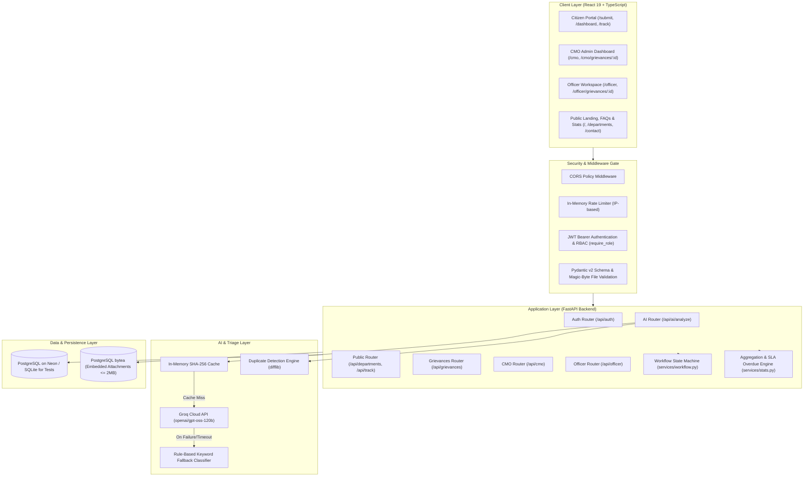
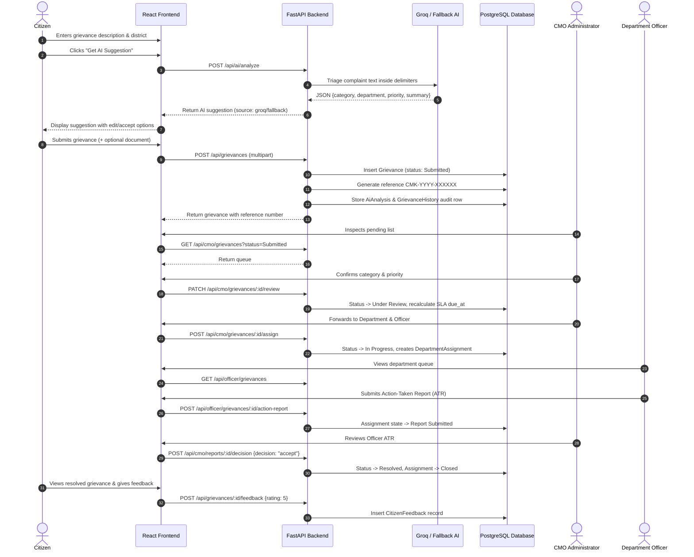

# 02. System Architecture — CM Kerala Public Grievance Redressal Portal

## 1. High-Level Architectural Layers

---

## 2. Component Breakdown

### 2.1 Frontend Client (React 19 + Vite + Tailwind CSS v4)
- **Framework:** React 19 with Vite 8 development server and Rolldown/Rollup optimized bundling.
- **Routing & State:** React Router 7 declarative routing with protected route guards by user role claim (`citizen`, `cmo_admin`, `officer`).
- **Resilient Dual-Mode API Client (`api.ts`):** Talks directly to FastAPI backend over JSON and multipart `FormData`. If the backend is starting up (cold start) or offline, automatically switches to an in-memory mock store so all views remain responsive.
- **Theme & UI:** Clean governmental design language with custom status badges (`status-submitted`, `status-under-review`, etc.), priority indicators, responsive modals, and accessible Lucide SVG iconography.

### 2.2 API & Gateway (FastAPI + Pydantic v2)
- **FastAPI Framework:** Asynchronous, self-documenting REST API with OpenAPI/Swagger interactive documentation at `/docs` and `/redoc`.
- **Validation:** Pydantic v2 data models enforcing string length boundaries, Kerala district enums, category constraints, 10-digit Indian phone numbers, and strict status enums.
- **Rate Limiting:** In-memory bucket rate limiter protecting login, public contact form, and AI triage endpoints from denial-of-service attempts.
- **Attachment Sanitization (`uploads.py`):** Multi-stage validation checking file size (<= 2MB), allowed extensions (`.jpg`, `.jpeg`, `.png`, `.pdf`), content-type headers, and binary magic bytes (`\xff\xd8\xff`, `\x89PNG`, `%PDF`).

### 2.3 Persistence Layer (SQLAlchemy 2.0 + PostgreSQL / SQLite)
- **Database Engine:** SQLAlchemy 2.0 ORM with declarative mapping and relationships.
- **Production Target:** Serverless PostgreSQL on Neon with `pool_pre_ping=True` and connection resilience against serverless auto-suspend.
- **Test Target:** Fully isolated in-memory SQLite database (`sqlite:///:memory:`) using `StaticPool` to ensure zero disk side-effects during rapid test runs.
- **Internal Binary Storage:** Uploaded citizen evidence and officer action reports are stored directly in PostgreSQL as `bytea` (`LargeBinary`), eliminating dependency on external S3 buckets.

### 2.4 AI Assistant Layer (Groq `openai/gpt-oss-120b`)
- **Model:** Open-weights foundation model `openai/gpt-oss-120b` hosted on Groq's high-speed LPU infrastructure.
- **Prompt Injection Defense:** Delimited input (`<<<USER_GRIEVANCE>>>`) instructed strictly as inert data to classify, not instructions to execute.
- **Deterministic Fallback:** Keyword heuristic classifier with clearly labeled `source: "fallback"` if Groq rate limits, times out, or fails.
- **Deduplication:** Text similarity matching against active grievances within the same district from the previous 60 days.

---

## 3. End-to-End Request Flow Sequence

