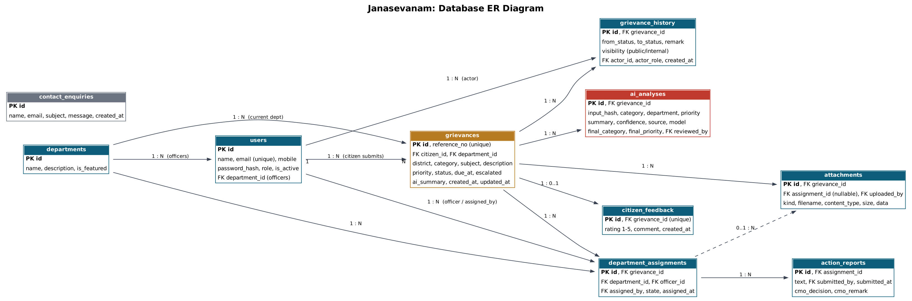
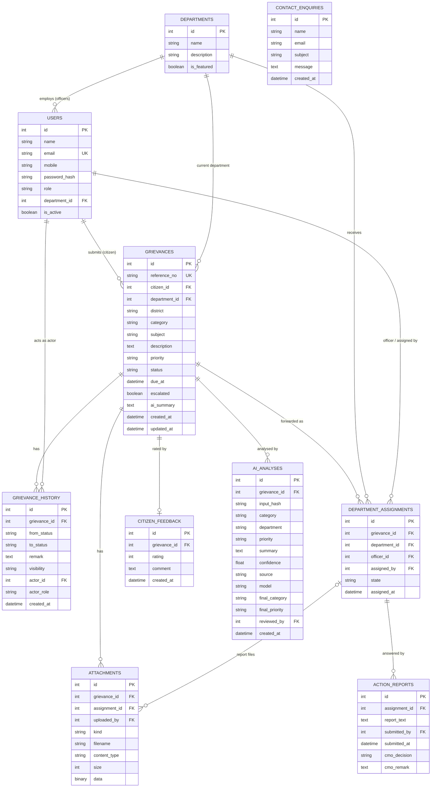

# 03. Database Design

> **Recruitment prototype.** Not affiliated with or endorsed by the Government of Kerala or the Chief Minister's Office. All data is fictional.

Database: **PostgreSQL** (hosted on Neon). Access layer: SQLAlchemy. Tables are created automatically on startup and filled with fictional demo data by the seed script.

---

## 1. Entity overview

| Table | Purpose | Required by the brief |
|---|---|---|
| `users` | Citizens, CMO administrators and department officers | Users |
| `departments` | Government departments (fictional) | Departments |
| `grievances` | One row per submitted grievance | Grievances |
| `grievance_history` | One row for every status change or remark | Grievance History |
| `department_assignments` | Which department and officer a grievance was forwarded to | Department Assignments |
| `attachments` | Uploaded files (grievance attachments and action-report files) | Attachments |
| `citizen_feedback` | Rating and comment after resolution | Citizen Feedback |
| `contact_enquiries` | Messages sent from the Contact Us form | Contact Enquiries |
| `action_reports` | Action-taken reports submitted by officers and the CMO's decision | Supporting table |
| `ai_analyses` | AI suggestions with the citizen's and CMO's final choices | Supporting table |

## 2. ER diagram

The same diagram in Mermaid (rendered by GitHub):

## 3. Table definitions

Types are logical types; PostgreSQL maps them to its native types.

### 3.1 `users`
| Column | Type | Notes |
|---|---|---|
| id | integer, PK | |
| name | string | Full name |
| email | string, unique | Login identifier |
| mobile | string | 10-digit Indian mobile number |
| password_hash | string | Salted hash, never the password |
| role | string | `citizen`, `cmo_admin` or `officer` |
| department_id | integer, FK to `departments` | Only for officers |
| is_active | boolean | Account enabled |

### 3.2 `departments`
| Column | Type | Notes |
|---|---|---|
| id | integer, PK | |
| name | string | For example Public Works |
| description | text | Short description shown on the Departments page |
| is_featured | boolean | Shown on the Home page |

### 3.3 `grievances`
| Column | Type | Notes |
|---|---|---|
| id | integer, PK | |
| reference_no | string, unique | Format `CMK-2026-000123`, created on the server |
| citizen_id | integer, FK to `users` | Submitting citizen |
| department_id | integer, FK to `departments` | Current department (null until forwarded) |
| district | string | One of the 14 Kerala districts |
| category | string | From the allowed category list |
| subject | string | Short title |
| description | text | Detailed complaint |
| priority | string | `Low`, `Medium` or `High` |
| status | string | `Submitted`, `Under Review`, `In Progress`, `Resolved`, `Reopened` |
| due_at | timestamp | Based on priority |
| escalated | boolean | Set by the CMO for delayed grievances |
| ai_summary | text | Short summary for the CMO |
| created_at, updated_at | timestamp | |

### 3.4 `grievance_history`
One row per status change or remark. Rows are only ever inserted, never edited, which keeps the lifecycle traceable.

| Column | Type | Notes |
|---|---|---|
| id | integer, PK | |
| grievance_id | integer, FK | |
| from_status, to_status | string | Equal when a remark is added without a status change |
| remark | text | |
| visibility | string | `public` (citizen can see) or `internal` (CMO and officers only) |
| actor_id | integer, FK to `users` | Responsible user |
| actor_role | string | Role at the time of the action |
| created_at | timestamp | When it happened |

### 3.5 `department_assignments`
| Column | Type | Notes |
|---|---|---|
| id | integer, PK | |
| grievance_id | integer, FK | |
| department_id | integer, FK | |
| officer_id | integer, FK to `users` | Assigned officer |
| assigned_by | integer, FK to `users` | The CMO user who forwarded it |
| state | string | `Assigned`, `Report Submitted`, `Returned`, `Closed` |
| assigned_at | timestamp | |

### 3.6 `action_reports`
| Column | Type | Notes |
|---|---|---|
| id | integer, PK | |
| assignment_id | integer, FK | |
| report_text | text | Action taken |
| submitted_by | integer, FK to `users` | Officer |
| submitted_at | timestamp | |
| cmo_decision | string | `accepted` or `returned` (empty until reviewed) |
| cmo_remark | text | Required when returning a report |

### 3.7 `attachments`
| Column | Type | Notes |
|---|---|---|
| id | integer, PK | |
| grievance_id | integer, FK | |
| assignment_id | integer, FK, nullable | Set for action-report files |
| uploaded_by | integer, FK to `users` | |
| kind | string | `grievance` or `action_report` |
| filename, content_type | string | |
| size | integer | Bytes, at most 2 MB |
| data | binary | The file contents |

### 3.8 `citizen_feedback`
| Column | Type | Notes |
|---|---|---|
| id | integer, PK | |
| grievance_id | integer, FK, unique | One feedback per grievance |
| rating | integer | 1 to 5 |
| comment | text | |
| created_at | timestamp | |

### 3.9 `contact_enquiries`
| Column | Type | Notes |
|---|---|---|
| id | integer, PK | |
| name, email, subject | string | |
| message | text | |
| created_at | timestamp | |

### 3.10 `ai_analyses`
| Column | Type | Notes |
|---|---|---|
| id | integer, PK | |
| grievance_id | integer, FK | |
| input_hash | string | Hash of the analysed text |
| category, department, priority | string | What the AI (or fallback) suggested |
| summary | text | Short summary for the CMO |
| confidence | float | 0 to 1 |
| source | string | `groq` or `fallback` |
| model | string | Model name used |
| final_category, final_priority | string | The human's final choice |
| reviewed_by | integer, FK to `users` | Citizen or CMO who confirmed or overrode |
| created_at | timestamp | |

## 4. Relationships

| Relationship | Cardinality | Meaning |
|---|---|---|
| users to grievances | one to many | A citizen submits many grievances |
| departments to users | one to many | A department has many officers |
| departments to grievances | one to many | The department a grievance is currently with |
| grievances to grievance_history | one to many | Every status change and remark |
| users to grievance_history | one to many | The responsible user of each entry |
| grievances to department_assignments | one to many | A grievance can be forwarded more than once (rework, reopening) |
| departments and users to department_assignments | one to many | Receiving department, officer and CMO user |
| department_assignments to action_reports | one to many | Reports submitted for an assignment |
| grievances to attachments | one to many | Supporting files |
| department_assignments to attachments | one to many, optional | Files attached to action reports |
| grievances to citizen_feedback | one to zero-or-one | One feedback after resolution |
| grievances to ai_analyses | one to many | Initial analysis and later reviews |

## 5. Constraints and indexes

- Unique: `users.email`, `grievances.reference_no`, `citizen_feedback.grievance_id`
- Foreign keys on every relationship above
- Indexed columns for filters and dashboards: `grievances.district`, `category`, `priority`, `status`, `department_id`, `due_at`, `citizen_id`; `grievance_history.grievance_id`; `department_assignments.officer_id`
- Value rules are enforced in the application: status, priority, role, visibility and assignment state come from fixed lists, and the feedback rating must be 1 to 5

## 6. Design notes

| Topic | Decision |
|---|---|
| Reference number | `CMK-` plus the year plus the grievance id padded to six digits, created in the same transaction as the insert |
| History | Insert-only table; every change goes through the workflow function, so the lifecycle is always traceable |
| Visibility | A single `visibility` field on history rows separates public remarks from internal ones |
| Overdue | Not stored; computed as `due_at` in the past and status not Resolved |
| Files | Stored as binary data in the database so they survive restarts on free hosting |
| Portability | String statuses and a binary column keep the schema usable on PostgreSQL in production and on an in-memory database in tests |
| Privacy | No real personal data; the public tracker query selects only status, department, dates and public history |

## 7. Demo data

The seed script creates fictional data only, and can be run more than once safely:
- Ten sample departments
- One CMO administrator, several officers in different departments, and several citizens (emails use the reserved `example.test` domain)
- About 25 grievances across districts, categories, priorities and every status, including overdue and escalated ones, with history rows, assignments, action reports and feedback

Demo login details are listed in the root `README.md`.
