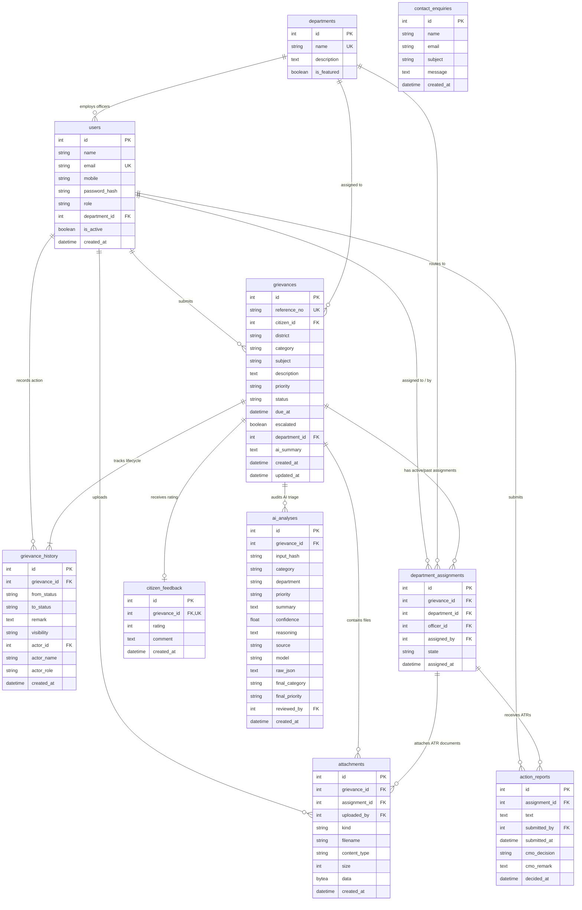

# 03. Database Design — CM Kerala Public Grievance Redressal Portal

## 1. Entity-Relationship Diagram

---

## 2. Table Schemas & Constraints

### 2.1 `users`
Stores all portal actors across roles (`citizen`, `cmo_admin`, `officer`).
| Column | Type | Constraints | Description |
|---|---|---|---|
| `id` | Integer | PK, Auto-increment, Index | Unique user ID |
| `name` | String(100) | NOT NULL | User's full name |
| `email` | String(120) | UNIQUE, Index, NOT NULL | Account login email |
| `mobile` | String(20) | NOT NULL | 10-digit Indian phone number |
| `password_hash` | String(255) | NOT NULL | Direct bcrypt salted password hash |
| `role` | String(30) | NOT NULL | Role: `citizen`, `cmo_admin`, `officer` |
| `department_id` | Integer | FK(`departments.id`), NULL | Applicable to `officer` role |
| `is_active` | Boolean | DEFAULT True, NOT NULL | Account active flag |
| `created_at` | DateTime | DEFAULT UTC NOW, NOT NULL | Account registration date |

### 2.2 `departments`
The 10 official state departments responsible for grievance execution.
| Column | Type | Constraints | Description |
|---|---|---|---|
| `id` | Integer | PK, Auto-increment, Index | Department ID |
| `name` | String(120) | UNIQUE, Index, NOT NULL | Official department title |
| `description` | Text | NOT NULL | Department mandate & responsibilities |
| `is_featured` | Boolean | DEFAULT True, NOT NULL | Displayed on public landing cards |

### 2.3 `grievances`
Core entity tracking citizen complaints from submission through resolution.
| Column | Type | Constraints | Description |
|---|---|---|---|
| `id` | Integer | PK, Auto-increment, Index | Internal numeric identifier |
| `reference_no` | String(40) | UNIQUE, Index, NULL (flushed) | Public identifier `CMK-YYYY-XXXXXX` |
| `citizen_id` | Integer | FK(`users.id`), Index, NOT NULL | Foreign key of submitting citizen |
| `district` | String(60) | Index, NOT NULL | One of 14 Kerala districts |
| `category` | String(80) | Index, NOT NULL | One of 10 allowed categories |
| `subject` | String(255) | NOT NULL | Complaint title (8–255 chars) |
| `description` | Text | NOT NULL | Detailed grievance explanation |
| `priority` | String(20) | Index, DEFAULT 'Medium', NOT NULL | Priority: `High`, `Medium`, `Low` |
| `status` | String(30) | Index, DEFAULT 'Submitted', NOT NULL | `Submitted`, `Under Review`, `In Progress`, `Resolved`, `Reopened` |
| `due_at` | DateTime | Index, NOT NULL | SLA deadline computed from priority |
| `escalated` | Boolean | Index, DEFAULT False, NOT NULL | CMO administrative escalation flag |
| `department_id` | Integer | FK(`departments.id`), Index, NULL | Responsible department |
| `ai_summary` | Text | NULL | 1–2 sentence AI executive summary |
| `created_at` | DateTime | Index, DEFAULT UTC NOW, NOT NULL | Submission timestamp |
| `updated_at` | DateTime | DEFAULT UTC NOW, NOT NULL | Last modification timestamp |

### 2.4 `grievance_history`
Append-only audit trail logging every state transition, remark, and escalation.
| Column | Type | Constraints | Description |
|---|---|---|---|
| `id` | Integer | PK, Auto-increment, Index | History entry identifier |
| `grievance_id` | Integer | FK(`grievances.id`), Index, NOT NULL | Parent grievance |
| `from_status` | String(30) | NULL | State prior to transition |
| `to_status` | String(30) | NOT NULL | Target state after transition |
| `remark` | Text | NOT NULL | Action justification / progress remark |
| `visibility` | String(20) | DEFAULT 'Public', NOT NULL | `Public` or `Internal` (CMO only) |
| `actor_id` | Integer | FK(`users.id`), NULL | User initiating the action |
| `actor_name` | String(100) | NULL | Actor's display name |
| `actor_role` | String(50) | NOT NULL | Role recorded at the moment of change |
| `created_at` | DateTime | Index, DEFAULT UTC NOW, NOT NULL | Audit timestamp |

### 2.5 `department_assignments`
Tracks routing of grievances to specific departments and nodal officers.
| Column | Type | Constraints | Description |
|---|---|---|---|
| `id` | Integer | PK, Auto-increment, Index | Assignment ID |
| `grievance_id` | Integer | FK(`grievances.id`), Index, NOT NULL | Assigned grievance |
| `department_id` | Integer | FK(`departments.id`), Index, NOT NULL | Target department |
| `officer_id` | Integer | FK(`users.id`), Index, NULL | Assigned departmental officer |
| `assigned_by` | Integer | FK(`users.id`), NOT NULL | CMO user who routed the assignment |
| `state` | String(40) | DEFAULT 'Assigned', NOT NULL | `Assigned`, `Report Submitted`, `Returned`, `Closed` |
| `assigned_at` | DateTime | DEFAULT UTC NOW, NOT NULL | Assignment creation timestamp |

### 2.6 `attachments`
Binary document storage persisting files directly in the database (`bytea`).
| Column | Type | Constraints | Description |
|---|---|---|---|
| `id` | Integer | PK, Auto-increment, Index | Attachment ID |
| `grievance_id` | Integer | FK(`grievances.id`), Index, NOT NULL | Associated grievance |
| `assignment_id` | Integer | FK(`department_assignments.id`), NULL | Optional link to action report |
| `uploaded_by` | Integer | FK(`users.id`), NOT NULL | Submitting user ID |
| `kind` | String(30) | DEFAULT 'grievance', NOT NULL | `grievance` or `action_report` |
| `filename` | String(255) | NOT NULL | Original sanitized filename |
| `content_type` | String(100) | NOT NULL | Verified MIME type |
| `size` | Integer | NOT NULL | File size in bytes (max 2 MB) |
| `data` | LargeBinary (`bytea`) | NOT NULL | Binary file contents |
| `created_at` | DateTime | DEFAULT UTC NOW, NOT NULL | Upload timestamp |

### 2.7 `action_reports`
Action-Taken Reports (ATRs) submitted by officers upon completing field tasks.
| Column | Type | Constraints | Description |
|---|---|---|---|
| `id` | Integer | PK, Auto-increment, Index | Report ID |
| `assignment_id` | Integer | FK(`department_assignments.id`), Index, NOT NULL | Department assignment |
| `text` | Text | NOT NULL | Action taken summary |
| `submitted_by` | Integer | FK(`users.id`), NOT NULL | Officer who filed report |
| `submitted_at` | DateTime | DEFAULT UTC NOW, NOT NULL | Submission timestamp |
| `cmo_decision` | String(30) | NULL | `accept` or `return` |
| `cmo_remark` | Text | NULL | CMO review remarks |
| `decided_at` | DateTime | NULL | Review decision timestamp |

### 2.8 `citizen_feedback`
Citizen feedback submitted following resolution (strictly 1 feedback per grievance).
| Column | Type | Constraints | Description |
|---|---|---|---|
| `id` | Integer | PK, Auto-increment, Index | Feedback ID |
| `grievance_id` | Integer | FK(`grievances.id`), UNIQUE, Index, NOT NULL | 1-to-1 link to resolved grievance |
| `rating` | Integer | NOT NULL (1 to 5) | Star rating |
| `comment` | Text | NULL | Qualitative citizen comment |
| `created_at` | DateTime | DEFAULT UTC NOW, NOT NULL | Timestamp |

### 2.9 `contact_enquiries`
Public inquiries submitted via the public contact form.
| Column | Type | Constraints | Description |
|---|---|---|---|
| `id` | Integer | PK, Auto-increment, Index | Enquiry ID |
| `name` | String(100) | NOT NULL | Contact name |
| `email` | String(120) | NOT NULL | Contact email |
| `subject` | String(200) | NOT NULL | Message subject |
| `message` | Text | NOT NULL | Inquiry text |
| `created_at` | DateTime | DEFAULT UTC NOW, NOT NULL | Timestamp |

### 2.10 `ai_analyses`
Auditing of all AI triage recommendations, confidence levels, and human overrides.
| Column | Type | Constraints | Description |
|---|---|---|---|
| `id` | Integer | PK, Auto-increment, Index | Analysis ID |
| `grievance_id` | Integer | FK(`grievances.id`), Index, NULL | Linked grievance (set on submit) |
| `input_hash` | String(64) | Index, NOT NULL | SHA-256 hash of input text |
| `category` | String(80) | NOT NULL | AI recommended category |
| `department` | String(120) | NOT NULL | AI recommended department |
| `priority` | String(20) | NOT NULL | AI recommended priority |
| `summary` | Text | NOT NULL | AI generated summary |
| `confidence` | Float | NOT NULL | Confidence score (0.0 to 1.0) |
| `reasoning` | Text | NULL | Explanation of AI classification |
| `source` | String(30) | NOT NULL | `groq` or `fallback` |
| `model` | String(80) | NOT NULL | Model identifier |
| `raw_json` | Text | NULL | Raw JSON returned by LLM |
| `final_category` | String(80) | NULL | Final category set by human reviewer |
| `final_priority` | String(20) | NULL | Final priority set by human reviewer |
| `reviewed_by` | Integer | FK(`users.id`), NULL | CMO reviewer user ID |
| `created_at` | DateTime | DEFAULT UTC NOW, NOT NULL | Analysis timestamp |

